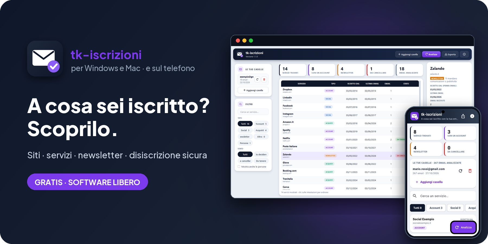
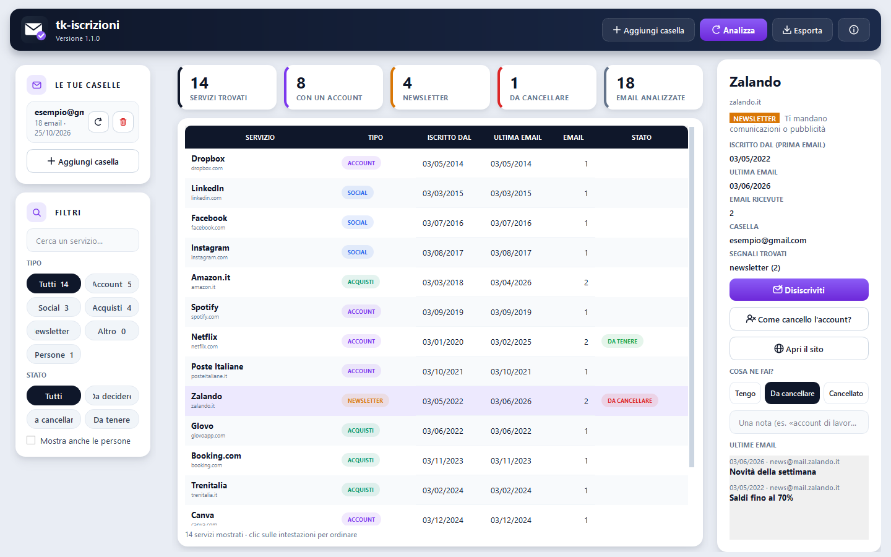

<!-- README generato da Dropbox/CLAUDE/dev/agpl-rollout/readme/genera_readme.py: modificare lì -->
<div align="center">



<br><br>

<a href="https://pietrodefilippis.it/scarica-programma/tk-iscrizioni/windows/"></a> &nbsp; <a href="https://pietrodefilippis.it/scarica-programma/tk-iscrizioni/mac/"></a> &nbsp; <a href="https://pietrodefilippis.it/donazione/"></a>

<br><br>

<a href="COPYING"></a>    

<br>

### Scopri a cosa sei iscritto con la tua email. E disiscriviti in un clic.

Siti, servizi, newsletter e negozi trovati leggendo solo le intestazioni delle email: sul tuo computer, in sola lettura.

</div>

---

## ✨ Cosa fa

<table>
<tr>
<td width="50%" valign="top">

### 📬&nbsp; Tutte le tue caselle
Le caselle email più diffuse e ogni casella IMAP.

</td>
<td width="50%" valign="top">

### 🧭&nbsp; Servizi trovati
Social, acquisti, account e newsletter, con la data della prima e dell'ultima email.

</td>
</tr>
<tr>
<td width="50%" valign="top">

### 🚪&nbsp; Disiscriviti in un clic
Usa il link ufficiale di disiscrizione, solo da email autentiche (firma DKIM), e ti mostra dove porta prima di aprirlo.

</td>
<td width="50%" valign="top">

### 🗑️&nbsp; Come cancello l'account?
Per i servizi con un account ti porta alla pagina giusta per chiuderlo.

</td>
</tr>
<tr>
<td width="50%" valign="top">

### 🏷️&nbsp; Decidi tu
Segna cosa tenere e cosa cancellare, con una nota per ogni servizio.

</td>
<td width="50%" valign="top">

### 📊&nbsp; Esporta
Tutto l'elenco in un file per fogli di calcolo.

</td>
</tr>
</table>

## 🖥️ Com'è fatto

<div align="center">

</div>

## 📱 Anche sul telefono

**tk-iscrizioni** c'è anche per Android, gratis e libera come questo programma:
[tk-iscrizioni-app](https://github.com/tecnikgeek-repo/tk-iscrizioni-app).

<a href="https://github.com/tecnikgeek-repo/tk-iscrizioni-app"></a>

## 🔒 I tuoi dati

tk-iscrizioni legge **solo le intestazioni** (mittente, oggetto, data), **in sola lettura**: non apre il testo delle email e non ne segna, sposta o cancella nessuna. Email e password non passano da nessun server dell'autore.

| Resta sul tuo computer | Va in rete (e perché) |
|---|---|
| Email, oggetti e risultati | Il tuo fornitore di posta (per leggere le intestazioni) |
| Password, cifrate (Windows DPAPI / Portachiavi del Mac) | pietrodefilippis.it per gli aggiornamenti e la configurazione dell'accesso Outlook |
| Le tue note e scelte | Il sito del mittente, solo quando premi «Disiscriviti» |

Nessuna pubblicità, nessun account da creare. Le statistiche anonime partono **solo se le accetti** al primo avvio
(si cambiano quando vuoi). Gli aggiornamenti sono **firmati digitalmente**: il programma installa solo quelli
pubblicati dall'autore.

## 📥 Installazione

- **Windows 10 / 11** — scarica l'installer `.exe` e avvialo. Non servono i permessi di amministratore.
- **macOS** (Intel o Apple Silicon) — apri il `.dmg` e trascina l'app in *Applicazioni*. Al primo avvio: clic destro sull'app → *Apri*.

Gli aggiornamenti arrivano da soli: quando esce una versione nuova il programma te lo propone.

<details>
<summary><b>🛠️ Avviarlo dal codice sorgente</b></summary>

<br>

Serve **Python 3.12** o più recente.

```bash
python -m venv .venv
.venv\Scripts\python -m pip install pyside6-essentials certifi
.venv\Scripts\python run.py
```

Prove con un finto server di posta, senza rete: `python tests/test_core.py` e `python tests/test_ui_scan.py`.
Pacchetti: `installer\build.ps1` (Windows), `mac/build_mac.sh` (macOS).

</details>

## 📜 Licenza

**tk-iscrizioni** è software libero: © 2026 Pietro De Filippis (TecnikGeek), licenza
**[GNU Affero General Public License v3.0](COPYING)** o successiva. Puoi usarlo, studiarlo, modificarlo e
condividerlo; è fornito **così com'è, senza alcuna garanzia**. I testi delle licenze dei componenti inclusi
(Qt/PySide6, Python, certifi) sono nella cartella [`licenze/`](licenze/) e nel programma, in *Informazioni → Licenze e codice
sorgente*.

> Il nome **tk-iscrizioni** e il logo non sono coperti dalla licenza (AGPL, sezione 7): una versione modificata deve
> avere un nome e un logo diversi.

---

<div align="center">

**Ti è utile?** Tutte le funzioni sono gratis per tutti. Se vuoi, un caffè aiuta a migliorarlo e a crearne altri.

<a href="https://pietrodefilippis.it/donazione/"></a>

<sub>Creato da <a href="https://pietrodefilippis.it">Pietro De Filippis · TecnikGeek</a> — Webmaster & UX/UI Designer</sub>

</div>
